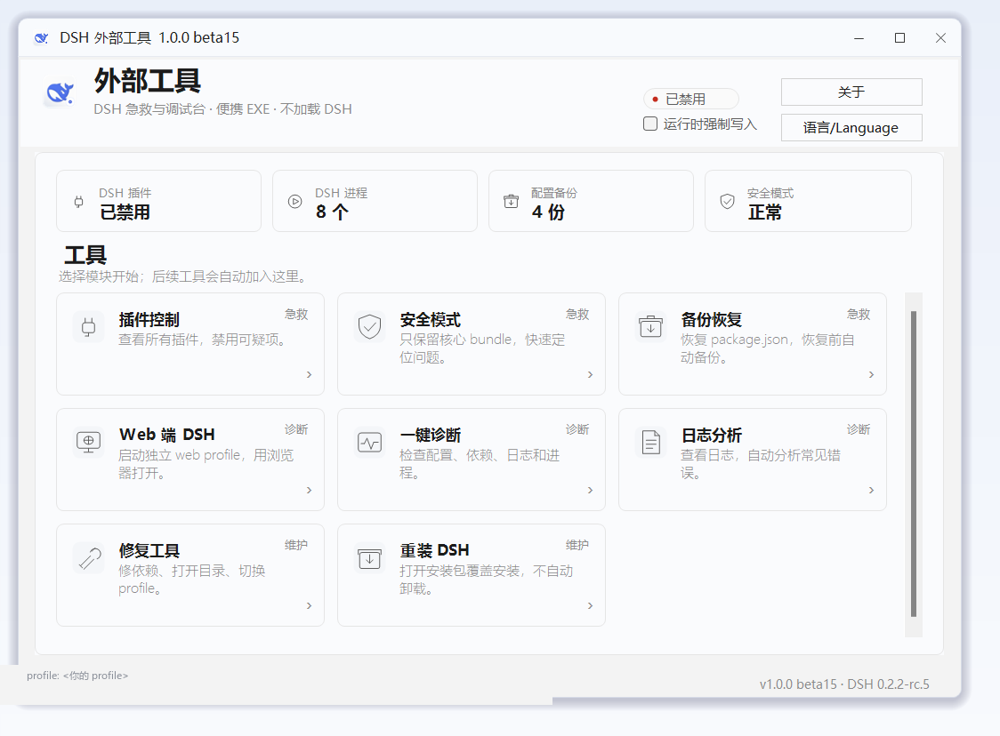
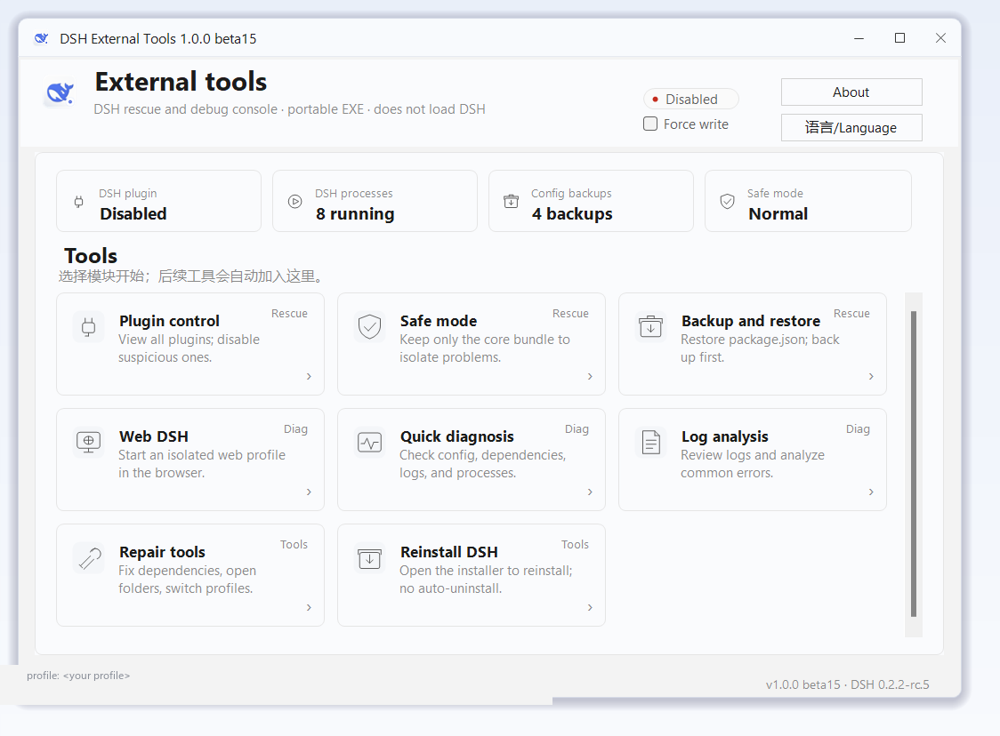

# dsh-external-tools：DSH 外部工具

**版本：1.0.0 beta15**（`package.json` 中为 `1.0.0-beta.15`）

DSH 的**独立急救/调试台**。单个便携 EXE，不加载 DSH、Node 或 Electron；DSH 崩溃、卡死、插件导致启动失败时，用它诊断配置和日志、进入安全模式、恢复备份、结束卡死进程、修依赖。

**独立运行，不依赖 DSH 插件，也不注册 DSH 设置页。** 双击即可运行，可独立分发。

[下载最新版](https://github.com/745403lkh/dsh-external-tools/releases/latest) · [更新日志](CHANGELOG.md) · [MIT](LICENSE)

## 预览





---

## 为什么需要它

插件能增强 DSH，也能让 DSH 起不来。一旦 DSH 打不开，设置、插件页、插件管理器都用不上。

`dsh-external-tools.exe` 直接读写 profile 文件，不依赖 DSH 运行时：

```
<profile>/package.json          → dsh.profile.bundles / dependencies
<profile>/cordis.patch.yml      → 用户 patch 层
<profile>/.dsh-external-tools/  → 备份、安全模式记录、操作日志
```

它能做的事情：

| 场景 | 工具里的动作 |
| --- | --- |
| 怀疑插件导致 DSH 起不来 | **修复 → 安全模式**：只保留 `dsh-base` / `dsh-web-app`，其余 bundle 临时移出启动列表；随时可退出恢复 |
| 某个插件明确有问题 | **插件**页选中后禁用；写入前备份、写入后校验 |
| 改坏了 `cordis.patch.yml` | **修复 → 重置 cordis.patch.yml**：先备份，再写回 `[]` |
| 依赖丢失 / `node_modules` 损坏 | **修复 → 打开终端修依赖**：在 profile 目录执行 `pnpm install --prefer-offline` |
| 卡死进程残留 | **首页/修复 → 结束 DSH 进程** |
| 想回到之前能用的配置 | **修复 → 备份恢复**：选中 `package.json` 备份恢复，恢复前再备份当前配置 |
| 不知道哪里坏了 | **诊断**：检查 JSON、bundle 列表、依赖、patch、日志、进程；**日志**页可做智能分析 |
| 需要给别人排查 | **诊断 → 导出诊断包**：ZIP 包含配置、patch、日志、bundle 列表、进程列表和诊断报告 |

---

## 快速开始

1. 双击：

   ```
   dsh-external-tools.exe
   ```

2. 首页会显示插件状态、DSH 进程数、备份数、安全模式状态。
3. 点 **一键诊断**，先看 `诊断` 页的 ERROR / WARN 和建议。
4. 如果 DSH 起不来，进 **安全模式** 模块，点 **安全模式并启动**；能起来就说明是某个插件的问题，再回 **插件控制** 逐个启用定位。
5. 需要回滚时，进 **备份恢复** 模块。

> EXE 是本地编译的未签名程序。Windows 首次运行如提示“未知发布者”，选择“更多信息 → 仍要运行”。它不联网、不上传配置，只读写本机 profile。

---

## EXE 界面

界面走 Windows 设置风格的极简视觉：浅灰底、白色圆角卡片、细边框、线性图标，只保留一个蓝色强调色。首页是模块卡片网格，点卡片进入独立模块；每个模块顶部有 **← 返回**。

- **插件控制**：全部 bundle，可筛选、双击切换；显示插件名称（包名在 tooltip），底部可 **查看详情 / 更新插件 / 打开目录**；更新走 npm registry，先备份 package.json；本地 link 和官方内置插件不走 npm 更新。
- **安全模式**：只保留核心 bundle，判断是不是插件导致 DSH 起不来；也包含 patch 重置和进程操作。
- **备份恢复**：列出 package.json 备份，恢复前再备份当前文件。
- **一键诊断**：profile/JSON、bundle 列表、依赖、patch、日志、进程；每条带级别和建议，可复制/导出诊断包。
- **日志分析**：列出 `hub.log`、`~/.dsh/logs/*.log` 等；查看尾部 500 行；**智能分析**常见报错。
- **Web 端 DSH**：启动独立的 `web` profile。使用 DSH 自带 CLI 的绝对路径（`DeepSeek Harness.exe + lib/bin.js web --port 0`）启动，不依赖 PATH 或 `DSH_*` 环境变量；web 与 desktop 的插件、设置、会话隔离。
- **修复工具**：pnpm 依赖修复、配置/日志/工具目录、切换 profile。
- **重装 DSH**：只打开官方安装包，不自动卸载/静默安装。优先使用 `%LOCALAPPDATA%\@deepseek-aidsh-desktop-updater\installer.exe`，找不到时弹出文件选择。
- **关于**：便携版说明、版本、路径、受保护列表、许可。

### 语言 / Language

- 支持 **简体中文 / English**，默认跟随系统。
- 系统语言是中文 → 中文；是英文 → English；其他语言 → 回退中文。
- 语言按钮在“关于”下方，固定显示 **语言/Language**；菜单包含 `跟随系统 / 简体中文 / English`，选择后立即重建界面，无需重启。
- 英文资源嵌入 EXE，不额外依赖语言文件；英文翻译由独立小智能体完成，主程序只保留资源接入层。

### 图标

- 以 DeepSeek 鲸鱼图标为底，重着色为浅蓝/深蓝，右下角加小齿轮徽章。
- 避开深红、深绿、纯黑；提供 16/24/32/48/64/128/256 多尺寸 ICO。
- `src-exe/make-icon.ps1` 可从 `whale-base.png` 重新生成图标；构建时若 `app.ico` 缺失会自动调用。

### DSH 版本校验

- 启动时读取 `DeepSeek Harness.exe` 的文件版本，与工具验证的系列 `0.2.2` 比较。
- 版本不匹配：启动弹窗提示，**重装入口禁用**；Web 端仍可尝试启动。
- 未找到 DSH：启动弹窗提示；**重装仍可用**（正好用来安装），Web 端不可用。
- DSH 路径依次从 `DSH_NODE_EXECUTABLE`、卸载注册表的 `InstallLocation`、常见安装目录查找；独立 EXE 从资源管理器启动也不依赖当前 shell 环境。
- 版本号同时显示在 EXE 底部和“关于”页。

### 模块化扩展

首页卡片由 `src-exe/Modules` 下的 `ToolModule` 自动生成。新增一个工具：

1. 新建 `XxxModule : ToolModule`，实现 `Title` / `Description` / `Category` / `IconId` / `Accent` / `CreateView`。
2. 在 `MainForm` 构造函数里 `modules.Add(new XxxModule());`。
3. 首页卡片、模块视图、刷新和 `--ui-preview` 会自动包含它；不需要改布局。

`Ui.cs` 提供统一的按钮、卡片、列表、只读文本；`ModuleIcon.cs` 提供线性图标；`ModuleCard.cs` 是首页卡片/状态控件。

### 智能日志分析

离线规则匹配，不是模型调用。常见模式与建议：

| 日志特征 | 判断 | 建议 |
| --- | --- | --- |
| `Cannot find module` / `ERR_MODULE_NOT_FOUND` | 依赖/插件文件缺失 | `pnpm install`；仍失败时安全模式 |
| `ERR_PACKAGE_PATH_NOT_EXPORTED` / `ERR_REQUIRE_ESM` | 插件模块格式不兼容 | 更新/回退插件，安全模式确认 |
| `SyntaxError` / `Unexpected token` | 插件代码语法错误 | 安全模式，逐个启用最近插件 |
| `EADDRINUSE` / `address already in use` | 端口被占用 | 结束卡死 DSH 进程 |
| `EACCES` / `EPERM` | 权限或文件被拒绝 | 关闭重复实例/占用程序，检查目录权限 |
| `ENOENT` | 文件/目录不存在 | 修依赖；插件目录丢失时禁用/恢复备份 |
| `YAMLException` / `bad indentation` | `cordis.patch.yml` 损坏 | 重置 patch 层（先备份） |
| `EJSONPARSE` / `is not valid JSON` | JSON 配置损坏 | 恢复 package.json 备份 |
| `JavaScript heap out of memory` | 内存不足 | 减少会话/插件，重启 |
| `ECONNREFUSED` / `ENOTFOUND` / `ETIMEDOUT` | 网络或模型接口不可达 | 检查网络/代理/API 地址 |
| `401` / `invalid api key` | 认证失效 | 重新登录/更新 Key |
| `429` / `rate limit` | 限流 | 稍后重试或降低并发 |
| `GPU process` / `GLES` / `Vulkan` | 图形初始化失败 | 更新驱动，禁用硬件加速 |
| `Segmentation fault` / `FATAL ERROR` | 进程崩溃 | 更新/重装 DSH，安全模式 |
| `ERR_DLOPEN_FAILED` / `NODE_MODULE_VERSION` | 原生模块 ABI 不匹配 | `pnpm rebuild` / 重装插件 |
| `UnhandledPromiseRejection` / `TypeError` | 插件异步/运行时异常 | 安全模式，更新插件 |

规则在 `src-exe/LogAnalyzer.cs`，可以继续加。分析会显示命中次数、文件、时间和一段样本；不会自动执行修复。

---

## 不再提供 DSH 设置页

- 设置页入口已移除，`client.js` 不再注册。
- 独立 EXE 不依赖 DSH、Node 或任何插件；直接双击或发给别人都能运行。
- DSH 插件不再提供 UI，也不需要为使用 EXE 而安装。

---

## 命令行后备

主入口是 EXE；命令行适合脚本，或者 EXE 无法启动时。

```text
dshx.cmd status  [--profile <名称|目录>] [--json]
dshx.cmd list    [--profile <名称|目录>] [--json]
dshx.cmd disable [插件名] [--profile <…>] [--force] [--json]
dshx.cmd enable  [插件名] [--profile <…>] [--json]
dshx.cmd backups [--profile <…>] [--json]
dshx.cmd where   [--profile <…>]
```

- 默认插件名：`dsh-external-tools`。
- 默认 profile：`%DSH_PROFILE_DIR%`；否则 `%DSH_HOME%\profiles\desktop`；再退回 `%USERPROFILE%\.dsh\profiles\desktop`。
- DSH 正在运行时默认拒绝写入（退出码 2），避免和运行中的实例互相覆盖；`--force` 可跳过。
- 写入前备份到 `<profile>\.dsh-external-tools\backups\`，写入后重新读取校验。
- 受保护插件拒绝禁用（退出码 3）。

---

## 安全设计

1. **只改目标字段**：`dsh.profile.bundles`，或重置 `cordis.patch.yml`。依赖、其他配置、插件目录不动。
2. **写前备份、写后校验**：备份保留最近 10 份；写入后重新解析并确认目标状态。
3. **受保护插件**：`@deepseek-ai/dsh-base`、`dsh-web-app`、`dsh-sdk-app`、`dsh-sdk-minimal`、`dsh-headless`、`dsh-acp-app`、`dsh-plugin-manager` 拒绝禁用。
4. **DSH 运行中默认拒绝写入**：EXE 和 CLI 都会先检查 `DeepSeek Harness` 进程；需要强制时必须在界面上显式勾选/确认。
5. **页面接口只接受本机请求**：自定义请求头、回环 Host、同源 Origin；无 CORS；请求体上限 64 KiB。
6. **不注册 Agent 工具**：启停/安全模式是用户动作，避免模型获得“关掉任意插件”的能力。
7. **EXE 不联网**：只读写本机文件、启动/结束本机进程；日志分析完全离线。

---

## 构建 EXE

`src-exe/build.ps1` 使用 Windows 自带的 .NET Framework 编译器，不需要 .NET SDK、Node 或 DSH：

```powershell
powershell -NoProfile -ExecutionPolicy Bypass -File .\src-exe\build.ps1
```

- 源文件：`Program.cs`（profile/备份/安全模式/自检）、`MainForm.cs`（模块壳）、`Ui.cs`（视觉基础/字体）、`ModuleIcon.cs`（线性图标）、`ModuleCard.cs`（卡片/状态控件）、`DshEnvironment.cs`（版本/Web/安装包）、`L.cs` + `L.en.cs`（中英资源）、`Modules/*.cs`（各工具模块）、`LogAnalyzer.cs`（日志规则）。
- 输出：根目录 `dsh-external-tools.exe`。
- 图标：`src-exe/app.ico`（缺失时由 `make-icon.ps1` 从 `whale-base.png` 生成多尺寸图标）。
- 自检：

  ```powershell
  .\dsh-external-tools.exe --self-test "C:\Users\<user>\.dsh\profiles\desktop" --out .\self-test.json
  ```

- 无界面诊断：

  ```powershell
  .\dsh-external-tools.exe --diagnose "C:\Users\<user>\.dsh\profiles\desktop" --out .\diagnose.json
  ```

- 界面预览（开发用，输出 Win11 风格窗口）：

  ```powershell
  .\dsh-external-tools.exe --ui-preview .\ui.png 0
  ```

---

## 已知限制

- **Windows only**：EXE 是 .NET Framework 4.x WinForms 程序；CLI 后备是 PowerShell。macOS/Linux 需要另写外壳。
- **需要 .NET Framework 4.x**：Windows 10/11 自带；极精简系统可能需要安装。
- **配置类修改需重启 DSH**：不热卸载插件。
- **会话数据库/缓存损坏**：目前只提示，不自动删除；请先备份 profile 再手动处理。
- **日志分析是启发式**：命中常见错误模式，不覆盖所有堆栈；最终以完整日志和复现为准。
- **安全模式只保留 base/web-app**：会临时停用所有可选官方 bundle 和第三方插件；退出时恢复。
- **EXE 未签名**：首次运行可能有 SmartScreen/杀毒提示。
- **界面验收**：已用 `--ui-preview` 逐页检查 1060×720 布局与按钮；不同 DPI/系统主题下仍建议实际打开确认。

---

## 目录结构

```
dsh-external-tools/
├─ dsh-external-tools.exe   # 独立急救台（主入口）
├─ package.json
├─ cordis.patch.yml
├─ index.js                 # DSH Host：同源接口

├─ lib/
│  ├─ profile.js            # profile 读写/备份/校验
│  ├─ routes.js             # 同源 HTTP 接口
│  └─ open.js               # 打开 EXE/目录/README
├─ src-exe/
│  ├─ Program.cs            # profile/备份/安全模式/自检/诊断
│  ├─ MainForm.cs           # 模块壳：首页卡片 + 模块视图
│  ├─ DshEnvironment.cs      # DSH 版本校验/Web 启动/安装包定位
│  ├─ L.cs                   # 中英资源/系统默认语言
│  ├─ L.en.cs                # 内嵌英文词典
│  ├─ whale-base.png         # DeepSeek 鲸鱼图标底图
│  ├─ make-icon.ps1          # 多尺寸鲸鱼+齿轮图标生成
│  ├─ ToolModule.cs         # 工具模块基类
│  ├─ Ui.cs                 # 极简视觉基础（按钮/卡片/列表）
│  ├─ ModuleIcon.cs         # 线性图标
│  ├─ ModuleCard.cs         # 首页卡片/状态控件
│  ├─ Modules/
│  │  ├─ PluginModule.cs
│  │  ├─ SafetyModule.cs
│  │  ├─ BackupModule.cs
│  │  ├─ DiagnoseModule.cs
│  │  ├─ LogModule.cs
│  │  ├─ WebModule.cs
│  │  ├─ RepairModule.cs
│  │  ├─ ReinstallModule.cs
│  │  └─ AboutModule.cs
│  ├─ LogAnalyzer.cs        # 常见日志规则
│  ├─ build.ps1             # 无 SDK 构建脚本
│  ├─ app.manifest
│  └─ app.ico
├─ bin/
│  ├─ dshx.cmd / dshx.ps1   # 命令行后备
│  ├─ disable-self.cmd
│  └─ enable-self.cmd
├─ locale/{zh,en}.json
├─ icon.svg
└─ README.md
```

---

## 仓库

- GitHub：https://github.com/745403lkh/dsh-external-tools
- 更新日志：[CHANGELOG.md](CHANGELOG.md)
- 发布步骤：[docs/RELEASING.md](docs/RELEASING.md)

## 许可

MIT。见 [LICENSE](LICENSE)。
